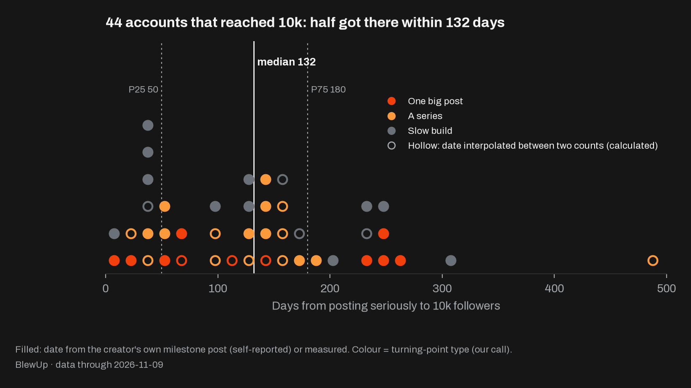
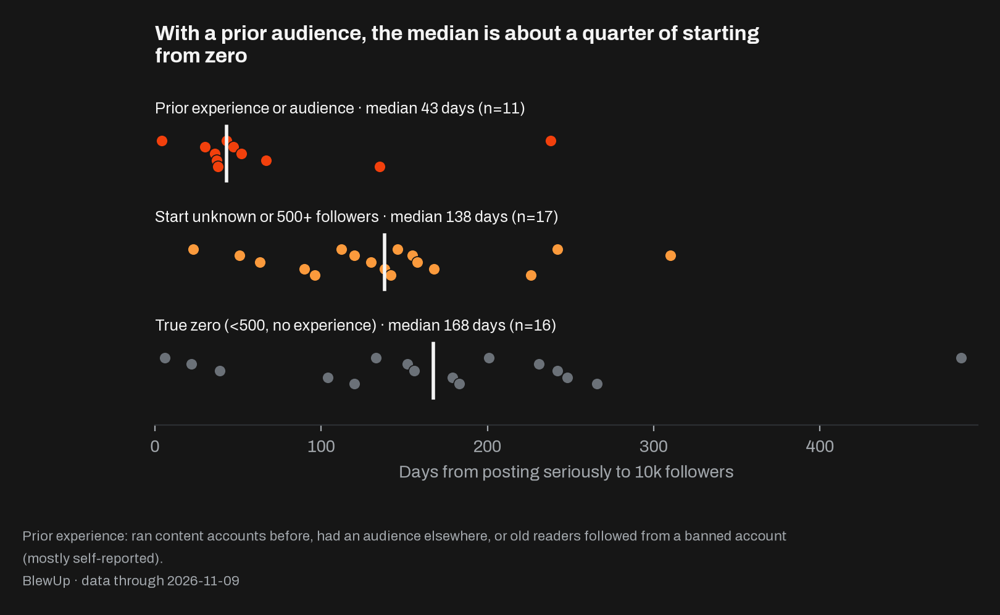
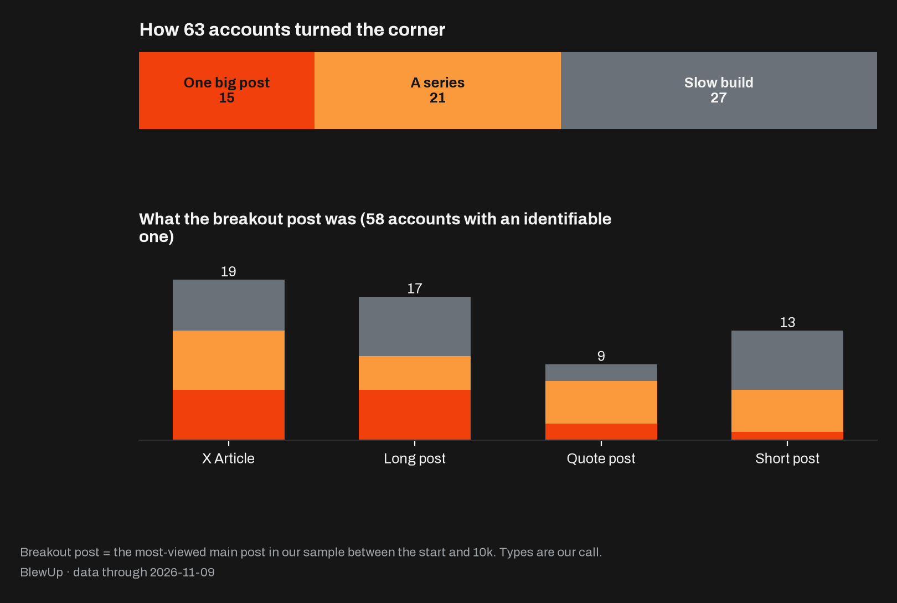
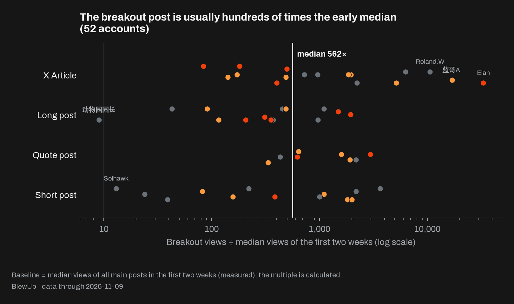
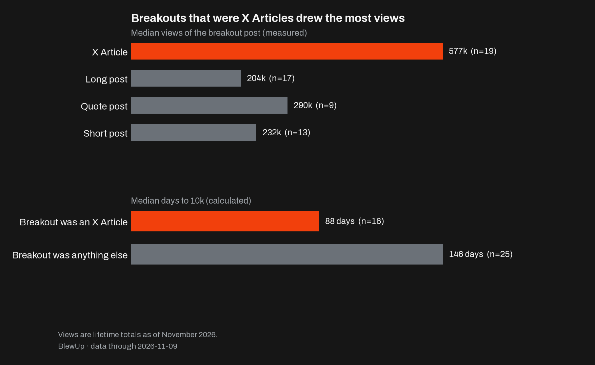
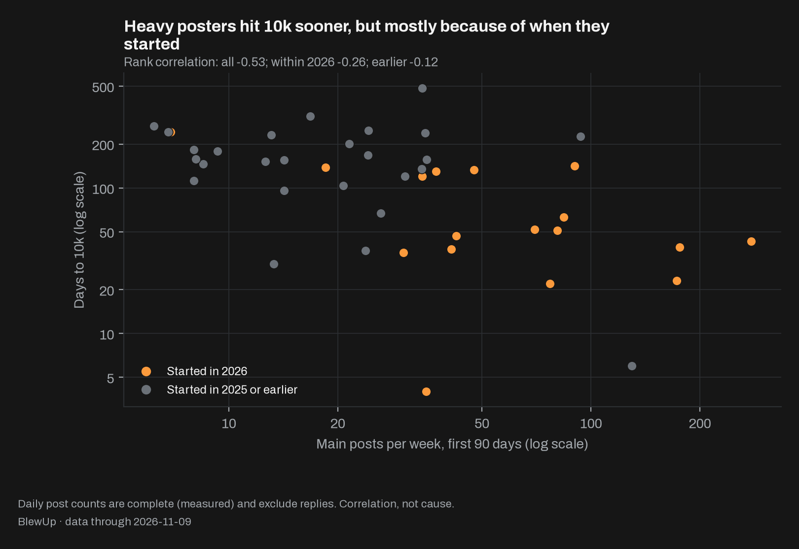
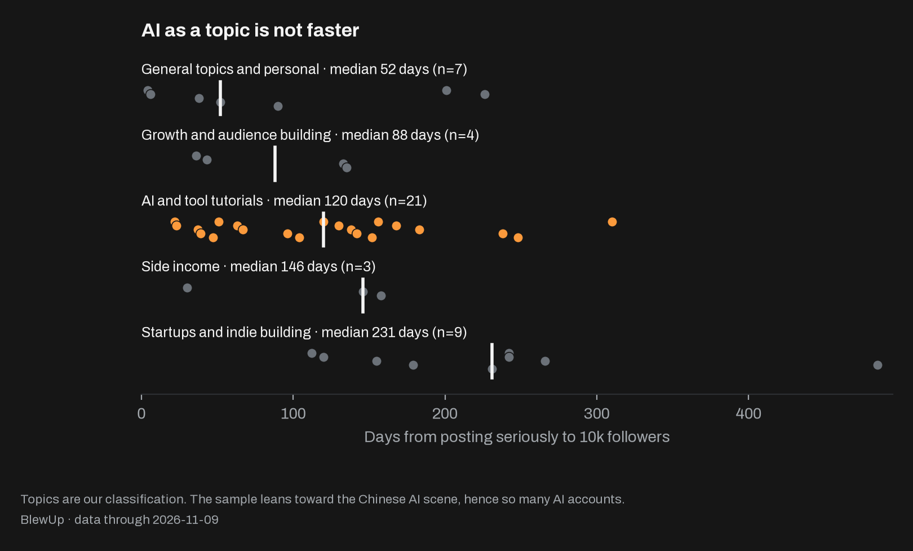
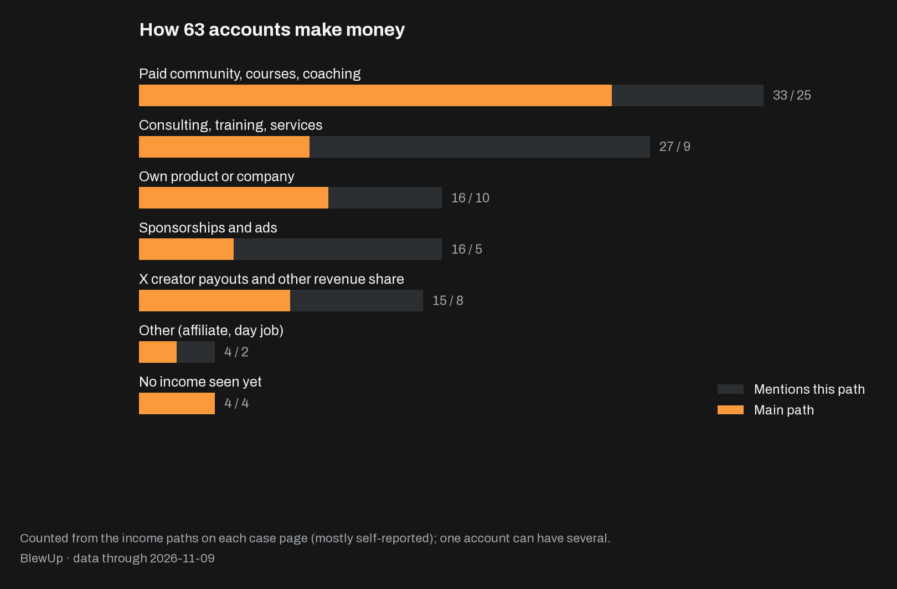

# How to fix your 𝕏 account in 1 day

You don't need another month of posting more. You need one day of honest decisions. We broke down 63 X accounts post by post, from their first serious post to 10k followers and beyond. The fast ones weren't more disciplined. They made a few choices early that the slow ones made late, or never. Here are eight ideas from that data, and a protocol to make those choices for your own account in a single day.

## Eight ideas

1. **The clock is longer than you think**: Half of the 44 accounts that reached 10k got there within 132 days. The fastest quarter took 50 or fewer; the slowest took 485.
2. **Where you start matters more than what you post**: With an audience from somewhere else, the median was 43 days. From under 500 followers with no experience, it was 168.
3. **You don't need to go viral**: Only 15 of 63 accounts grew mainly off one post. 21 rose on a repeated format, and 27 had no single turning point.
4. **Your best post will come later than you think**: It drew a median of 562 times the views of an early post, and it arrived 71% of the way to 10k.
5. **Write the long thing**: 19 breakout posts were X Articles, with median views of 577k. Those accounts took 88 days to 10k; the rest took 146.
6. **More posts won't save you**: Posting volume correlates with speed at −0.53, but among accounts that started in the same year it falls to −0.26 or −0.12.
7. **The topic isn't the shortcut. The tutorial is**: AI accounts took 120 days, the rest 135. But 15 of the 17 accounts whose breakout was a tool tutorial reached 10k.
8. **Sell before you feel ready**: 33 of 63 accounts sell a community, course or coaching. The first income signal came around day 80, usually before 10k.

## 01 The clock is longer than you think

Everyone wants the story where an account goes from nothing to 10k in a week. It happens: the fastest account in our sample took 4 days. It just isn't the story to plan around.

Of the 44 accounts whose time to 10k we know, a quarter got there within 50 days, half within 132 and three quarters within 180. The slowest took 485. Another 10 haven't made it yet, and for 9 we don't know the date.

Where an account comes from moves the clock a lot. 31 Chinese-language accounts had a median of 96 days, 13 English-language ones 201. But the English accounts are almost all founders building apps in public, while the Chinese ones are mostly AI content accounts, and 22 of the 46 started in 2026. Across the whole sample, the 17 accounts that started in 2026 and reached 10k had a median of 51 days; the 20 from 2025 took 154.

[Ryan](https://blewup.co/cases/ryangrowth/?utm_source=github&utm_medium=repo) took 36 days. [Miles Ma](https://blewup.co/zh/cases/milesma/?utm_source=github&utm_medium=repo) took 22. [Shizi (柿子)](https://blewup.co/zh/cases/shizi/?utm_source=github&utm_medium=repo) took 156. All three are on this chart. Find yourself on it before you decide you're failing.

*How it's measured: Days to 10k = the date of 10k minus the date the account started posting seriously. X doesn't publish follower history: of the 44 dates, 27 come from the creator's own milestone posts, 16 are interpolated between two known follower counts, and 1 was measured on the day we pulled the data. (Self-reported, Derived, Fact)*

Cases to read: [Ryan](https://blewup.co/cases/ryangrowth/?utm_source=github&utm_medium=repo) · [Miles Ma](https://blewup.co/zh/cases/milesma/?utm_source=github&utm_medium=repo) · [柿子](https://blewup.co/zh/cases/shizi/?utm_source=github&utm_medium=repo)

## 02 Where you start matters more than what you post

Look at the fastest accounts in the sample and you'll notice something uncomfortable: almost none of them started from zero.

We count an account as having prior experience if the creator had run content accounts before, had an audience on another platform, or brought old readers over from a banned account. The 11 such accounts that reached 10k had a median of 43 days, and three quarters made it within 60. The 16 that started under 500 followers with none of that had a median of 168, and a quarter needed 234 or more.

[Kin](https://blewup.co/zh/cases/kin/?utm_source=github&utm_medium=repo) had, by their own account, run a short-video account with a million followers, and took 47 days. [Koda](https://blewup.co/zh/cases/koda/?utm_source=github&utm_medium=repo) had made content for eight years and took 52. [huangserva](https://blewup.co/zh/cases/huangserva/?utm_source=github&utm_medium=repo) lost a previous account to a ban; the new one took 37 days, with a median of 6,744 views in its first two weeks. Experience isn't a guarantee: [Wenzi (文子)](https://blewup.co/zh/cases/wenzi/?utm_source=github&utm_medium=repo) had built a private-community business, not public content, and took 238 days.

22 of the 63 accounts started truly from zero; 17 brought experience or readers. If you're one of the 22, your clock is 168 days, not 132. That isn't bad news. It's the first honest number you can plan with.

*How it's measured: Starting follower counts come from the creator or the account profile. Prior experience is almost always self-reported; the classification is ours. (Derived, Self-reported, Our read)*

Cases to read: [Kin](https://blewup.co/zh/cases/kin/?utm_source=github&utm_medium=repo) · [Koda](https://blewup.co/zh/cases/koda/?utm_source=github&utm_medium=repo) · [huangserva](https://blewup.co/zh/cases/huangserva/?utm_source=github&utm_medium=repo)

## 03 You don't need to go viral

Most advice about X is advice about the one post. Write the thread that breaks out, get the repost from the big account, wake up to thousands of new followers.

Some accounts did grow that way. We call it one big post: a post or two after which the account gained over 30% of the followers it needed for 10k within days. That's 15 of 63. The clearest is [yan](https://blewup.co/zh/cases/zhanlinyan/?utm_source=github&utm_medium=repo), whose article on dating and sex drew 6.72 million views; by the creator's account, the account hit 10k within 48 hours.

The other 48 didn't. 21 rose on a series: one repeated format where several posts beat the account's norm and none carried 30% on its own, like [Chen Dahuang (陈大黄)](https://blewup.co/zh/cases/chendahuang/?utm_source=github&utm_medium=repo), who posted dozens of times about a self-built browser extension. 27 were a slow build with no turning point at all, like [Liangzi (良子)](https://blewup.co/zh/cases/liangzi/?utm_source=github&utm_medium=repo), whose best post in our sample had under 10,000 views; the account got to 10k in 43 days on more than 270 main posts and 2,000 replies a week.

Here's the part nobody tells you: all three got there at about the same speed. Medians of 112 days for one big post, 129 for a series and 133 for a slow build. Waiting for the viral post isn't a strategy. It isn't even faster.

*How it's measured: The turning-point type is our call, made from each case's notes and follower milestones. Views are measured lifetime totals as of November 2026. (Our read, Fact, Derived)*

Cases to read: [yan](https://blewup.co/zh/cases/zhanlinyan/?utm_source=github&utm_medium=repo) · [陈大黄](https://blewup.co/zh/cases/chendahuang/?utm_source=github&utm_medium=repo) · [良子](https://blewup.co/zh/cases/liangzi/?utm_source=github&utm_medium=repo)

## 04 Your best post will come later than you think

Call the most-viewed main post between the start and 10k the breakout post. For the 52 accounts where we can compute it, the breakout drew a median of 562 times the views of a typical post in the first two weeks. 51 cleared 10 times and 44 cleared 100 times. The one exception is [Dongwuyuan Yuanzhang (动物园园长)](https://blewup.co/zh/cases/yuanzhang/?utm_source=github&utm_medium=repo): friends shared the early posts so widely that the first-fortnight median was already 55,000.

Don't be impressed by the multiples. They're big because the early numbers are tiny. A post at 10 times your early median comes almost immediately: day 5 at the median for accounts that reached 10k, and 6 of the 10 that haven't did it within 35 days. Absolute views tell you more. For accounts that reached 10k, the first post over 100,000 views came on day 32 at the median.

What matters is when the breakout arrives. Measured against each account's time to 10k, it came 71% of the way through at the median; only a quarter had it before the halfway mark. [Cheery](https://blewup.co/zh/cases/cheery/?utm_source=github&utm_medium=repo) waited until day 204, [Wenzi (文子)](https://blewup.co/zh/cases/wenzi/?utm_source=github&utm_medium=repo) until day 207 and [Lange AI (蓝哥AI)](https://blewup.co/zh/cases/lange/?utm_source=github&utm_medium=repo) until day 112. If you quit at the halfway mark, you quit before the part that counts.

*How it's measured: Baseline = median views of every main post in the first two weeks of serious posting (measured). The breakout post is the highest in our sample: for most accounts that sample is the full first two weeks, each month's top posts and the last 30 days, so a mid-month hit can be missed. Multiples and positions are calculated. (Fact, Derived)*

Cases to read: [动物园园长](https://blewup.co/zh/cases/yuanzhang/?utm_source=github&utm_medium=repo) · [Cheery](https://blewup.co/zh/cases/cheery/?utm_source=github&utm_medium=repo) · [蓝哥AI](https://blewup.co/zh/cases/lange/?utm_source=github&utm_medium=repo)

## 05 Write the long thing

Of the 58 accounts with an identifiable breakout post, 19 broke out with an X Article, 17 with a long post (over 280 characters), 9 with a quote post and 13 with a short post. The 19 Articles had median views of 577k, roughly 2 to 2.8 times the other formats. The 16 Article-breakout accounts that reached 10k did so in a median of 88 days; the other 25 took 146.

You don't need many. [Kin](https://blewup.co/zh/cases/kin/?utm_source=github&utm_medium=repo) wrote only a handful, and one guide to connecting Grok Bot to WeChat drew 1.62 million views. [Miles Ma](https://blewup.co/zh/cases/milesma/?utm_source=github&utm_medium=repo) published a beginner's guide to GitHub on day 9 that drew 331k views, and reached 10k on day 22. [Lange AI (蓝哥AI)](https://blewup.co/zh/cases/lange/?utm_source=github&utm_medium=repo) wrote a getting-started guide on the day a new agent product launched: 2.16 million views. Across the sample, long-form made up a median of just 14% of early posts.

A short post asks for a second of attention. An Article asks to be saved. Write the one thing someone would bookmark. [Thomas Trimoreau](https://blewup.co/cases/trimoreau/?utm_source=github&utm_medium=repo) got to 10k in 133 days on almost nothing but short posts and replies, so it isn't the only way. It's the cheapest.

*How it's measured: Article = X Article; long post = more than 280 weighted characters (each Chinese character counts as 2). Views are measured lifetime totals; median days are calculated. (Fact, Derived)*

Cases to read: [Kin](https://blewup.co/zh/cases/kin/?utm_source=github&utm_medium=repo) · [Miles Ma](https://blewup.co/zh/cases/milesma/?utm_source=github&utm_medium=repo) · [Thomas Trimoreau](https://blewup.co/cases/trimoreau/?utm_source=github&utm_medium=repo)

## 06 More posts won't save you

When growth stalls, the reflex is to post more. At first the data seems to agree. In their first 90 days the accounts published a median of 27 main posts a week, and volume correlates with days to 10k at −0.53: the 16 accounts posting 35 or more a week reached 10k in a median of 49 days, the 27 posting fewer took 155.

Now split them by the year they started. Within 2026 the correlation falls to −0.26; for earlier accounts, −0.12. The 2026 accounts both posted more (a median of 41 a week against 21) and grew faster. Most of the gap is about when they started, not how much they posted.

[Adrian Punk](https://blewup.co/zh/cases/adrian-punk/?utm_source=github&utm_medium=repo) averaged about 176 main posts a week and reached 10k in about 39 days. [Alex](https://blewup.co/cases/hispanicnomad/?utm_source=github&utm_medium=repo) posted 93 a week and needed 226 days; [Mau Baron](https://blewup.co/cases/maubaron/?utm_source=github&utm_medium=repo) posted 8 a week and needed 112. Replies tell the same story: reply volume correlates with days to 10k at −0.36, but the ratio of replies to posts has almost nothing to do with speed (+0.08). Volume is a cost you pay, not a lever you pull.

*How it's measured: Daily post and reply counts are complete (measured); days to 10k and the correlations are calculated. This is correlation, not cause. (Fact, Derived, Our read)*

Cases to read: [Adrian Punk](https://blewup.co/zh/cases/adrian-punk/?utm_source=github&utm_medium=repo) · [Alex](https://blewup.co/cases/hispanicnomad/?utm_source=github&utm_medium=repo) · [Mau Baron](https://blewup.co/cases/maubaron/?utm_source=github&utm_medium=repo)

## 07 The topic isn't the shortcut. The tutorial is.

33 of the 63 accounts cover AI and tools, because our candidate list started in the Chinese AI scene. You'd expect AI to be the fast lane. It isn't. The 21 AI accounts that reached 10k had a median of 120 days; the 23 others, 135. Among Chinese-language accounts with no prior audience: 130 days for the 17 AI accounts, 118 for the 4 others.

Topics look further apart than that. General and personal topics were fastest (52 days) and startups and indie building slowest (231). But 3 of the 7 general-topic accounts brought experience or readers, and the fastest of them, 6 days, rests on self-reports at both ends. All 9 startup accounts are English-language founders with no prior audience. Topic and starting point are tangled together.

What does stand out is the form. Of the 17 accounts whose breakout post was a tool tutorial, 15 reached 10k, among them [Xuetawuyun (雪踏乌云)](https://blewup.co/zh/cases/xuetawuyun/?utm_source=github&utm_medium=repo) and [Kin](https://blewup.co/zh/cases/kin/?utm_source=github&utm_medium=repo). The two that haven't are [Ojas Sharma](https://blewup.co/cases/ojas/?utm_source=github&utm_medium=repo) and Sun Keke (孙可可). Pick the thing you can't stop using. Then teach it.

*How it's measured: Topics and breakout-post topics are our classification after reading the posts; median days are calculated. (Our read, Derived)*

Cases to read: [雪踏乌云](https://blewup.co/zh/cases/xuetawuyun/?utm_source=github&utm_medium=repo) · [Kin](https://blewup.co/zh/cases/kin/?utm_source=github&utm_medium=repo) · [Ojas Sharma](https://blewup.co/cases/ojas/?utm_source=github&utm_medium=repo)

## 08 Sell before you feel ready

33 of 63 accounts mention a paid community, course or coaching, and 25 rank it first. 27 mention consulting, training or services; 16 their own product or company; 16 sponsorships; 15 X creator payouts or other revenue share. For 4 we see no income yet.

The two languages differ. 23 of the 46 Chinese-language accounts rank a paid community or course first. Among the 17 English-language accounts, 8 rank their own product or company first and use X to find customers, like [Vitalii Dodonov](https://blewup.co/cases/vitalii/?utm_source=github&utm_medium=repo).

The timing is the part to steal. For the 22 accounts where we can see a first income signal (announcing a paid group, switching on creator payouts, landing a first client), the median is day 80 after they started posting seriously. Of the 16 accounts that both reached 10k and show an income signal, 13 earned first. [Kin](https://blewup.co/zh/cases/kin/?utm_source=github&utm_medium=repo) announced a paid group on day 14, and [Jay Dwivedi](https://blewup.co/cases/jaydwivedi/?utm_source=github&utm_medium=repo) released a paid template on day 81. Most didn't wait for 10k.

*How it's measured: Income paths are counted from what each case page lists; one account can have several. Nearly all of it is self-reported. Only 22 accounts show a dated first income signal. (Self-reported, Derived)*

Cases to read: [Kin](https://blewup.co/zh/cases/kin/?utm_source=github&utm_medium=repo) · [Vitalii Dodonov](https://blewup.co/cases/vitalii/?utm_source=github&utm_medium=repo) · [Jay Dwivedi](https://blewup.co/cases/jaydwivedi/?utm_source=github&utm_medium=repo)

## The 1-day protocol

Reading this changes nothing. Doing it might.

Block out one full day. Bring a notebook, your profile and the last 90 days of your own posts. You'll make four decisions: one in the morning, two in the afternoon, one in the evening. Each comes from the ideas above.

### Morning: set your clock

Answer these on paper, honestly:

- Who already listens to me somewhere else? An old account, another platform, a newsletter, a community, colleagues?
- What have I made that people used, paid for or shared?
- Am I really starting from zero?

Then write down one number. With a real audience elsewhere, your reference is 43 days. Starting under 500 followers with none, it's 168. Starting with 500 or more but no experience elsewhere, 138. That number isn't a deadline. It's how long you agree to keep going before you judge the result.

### Afternoon, part one: choose the one thing you'll repeat

- Which tool or topic do I use every week, whether or not anyone is watching?
- Where do beginners get stuck that I could explain with screenshots?

Write ten post ideas about it in one format you can repeat: same structure, different problem. If you can't get to ten, it's the wrong thing. Pick another and start again. Those ten are your series.

### Afternoon, part two: write the long one

Draft your first X Article: the complete guide you wish had existed when you started with that thing. Don't publish it today. Finish it today. Long-form only has to be about one post in seven; this is the one.

### Evening: set your signals

Write three lines in the notebook.

1. **My signal**: the first post over 100,000 views. For accounts that reached 10k, it came on day 32 at the median.
2. **My halfway rule**: the breakout came 71% of the way to 10k. If I'm halfway and nothing has hit, I'm on schedule, and I keep the format.
3. **My first offer**: what I'll sell, and the date it goes up. Somewhere around day 80, and before 10k.

Then pick a posting volume you can hold for your whole clock, not one that looks impressive this week. Close the notebook. Tomorrow, you post.

*How it's measured: This protocol is how we would put the eight ideas above to work; every number in it comes from those sections. (Our read)*

## The sample

One row per account, sorted by days to 10k.

- [yan](https://blewup.co/zh/cases/zhanlinyan/?utm_source=github&utm_medium=repo) @ZhanlinYan74392: Chinese, Started 2026-09-03, Days to 10k 4 days (Self-reported), Followers now 30.7k, Turning point One big post, Breakout post X Article · 6.72M, Posts a week, first 90 days 35, Topic General, personal, Main income Services
- [Solhawk](https://blewup.co/zh/cases/solhawk/?utm_source=github&utm_medium=repo) @SolhawkGo: Chinese, Started 2025-05-02, Days to 10k 6 days (Self-reported), Followers now 27.5k, Turning point Slow build, Breakout post Short post · 14.1k, Posts a week, first 90 days 130, Topic General, personal, Main income Community, courses
- [Miles Ma](https://blewup.co/zh/cases/milesma/?utm_source=github&utm_medium=repo) @miles_mazy: Chinese, Started 2026-08-07, Days to 10k 22 days (Derived), Followers now 38.9k, Turning point A series, Breakout post X Article · 330.8k, Posts a week, first 90 days 77, Topic AI and tools, Main income Community, courses
- [黄小木](https://blewup.co/zh/cases/xiaomu/?utm_source=github&utm_medium=repo) @ai_xiaomu: Chinese, Started 2026-04-02, Days to 10k 23 days (Self-reported), Followers now 56.5k, Turning point One big post, Breakout post Long post · 319.6k, Posts a week, first 90 days 173, Topic AI and tools, Main income Services
- [动物园园长](https://blewup.co/zh/cases/yuanzhang/?utm_source=github&utm_medium=repo) @weiyux2021: Chinese, Started 2025-11-29, Days to 10k 30 days (Self-reported), Followers now 96.4k, Turning point Slow build, Breakout post Long post · 501.2k, Posts a week, first 90 days 13, Topic Side income, Main income Community, courses
- [Ryan](https://blewup.co/cases/ryangrowth/?utm_source=github&utm_medium=repo) @ryangrowthh: English, Started 2026-10-03, Days to 10k 36 days (Fact), Followers now 10.2k, Turning point A series, Breakout post X Article · 464.9k, Posts a week, first 90 days 30, Topic Growth, Main income Other
- [huangserva](https://blewup.co/zh/cases/huangserva/?utm_source=github&utm_medium=repo) @servasyy_ai: Chinese, Started 2025-12-11, Days to 10k 37 days (Self-reported), Followers now 42.9k, Turning point Slow build, Breakout post Long post · 289.9k, Posts a week, first 90 days 24, Topic AI and tools, Main income Sponsorships
- [杨高能](https://blewup.co/zh/cases/yanggaoneng/?utm_source=github&utm_medium=repo) @430Yang: Chinese, Started 2026-01-07, Days to 10k 38 days (Derived), Followers now 41.3k, Turning point A series, Breakout post Quote post · 268.6k, Posts a week, first 90 days 41, Topic General, personal, Main income Services
- [Adrian Punk](https://blewup.co/zh/cases/adrian-punk/?utm_source=github&utm_medium=repo) @AdrianPunk115: Chinese, Started 2026-04-24, Days to 10k 39 days (Derived), Followers now 45.2k, Turning point Slow build, Breakout post X Article · 89.1k, Posts a week, first 90 days 176, Topic AI and tools, Main income Community, courses
- [良子](https://blewup.co/zh/cases/liangzi/?utm_source=github&utm_medium=repo) @xuliang198241: Chinese, Started 2026-09-15, Days to 10k 43 days (Self-reported), Followers now 11.3k, Turning point Slow build, Breakout post Short post · 9.9k, Posts a week, first 90 days 277, Topic Growth, Main income Revenue share
- [Kin](https://blewup.co/zh/cases/kin/?utm_source=github&utm_medium=repo) @KinGao476942: Chinese, Started 2026-09-01, Days to 10k 47 days (Self-reported), Followers now 15.4k, Turning point One big post, Breakout post X Article · 1.62M, Posts a week, first 90 days 42, Topic AI and tools, Main income Community, courses
- [金尘马](https://blewup.co/zh/cases/jinchenma/?utm_source=github&utm_medium=repo) @jinchenma_ai: Chinese, Started 2026-03-05, Days to 10k 51 days (Self-reported), Followers now 33.5k, Turning point A series, Breakout post X Article · 625.1k, Posts a week, first 90 days 81, Topic AI and tools, Main income Community, courses
- [Koda](https://blewup.co/zh/cases/koda/?utm_source=github&utm_medium=repo) @wadezone: Chinese, Started 2026-03-14, Days to 10k 52 days (Self-reported), Followers now 31.1k, Turning point A series, Breakout post X Article · 681.3k, Posts a week, first 90 days 70, Topic General, personal, Main income Services
- [Eian](https://blewup.co/zh/cases/eian/?utm_source=github&utm_medium=repo) @EianLu: Chinese, Started 2026-09-04, Days to 10k 63 days (Derived), Followers now 36.2k, Turning point One big post, Breakout post X Article · 5.33M, Posts a week, first 90 days 84, Topic AI and tools, Main income Sponsorships
- [雪踏乌云](https://blewup.co/zh/cases/xuetawuyun/?utm_source=github&utm_medium=repo) @Pluvio9yte: Chinese, Started 2025-10-09, Days to 10k 67 days (Self-reported), Followers now 81.9k, Turning point One big post, Breakout post Long post · 47.6k, Posts a week, first 90 days 26, Topic AI and tools, Main income Services
- [Mr Panda](https://blewup.co/zh/cases/mrpanda/?utm_source=github&utm_medium=repo) @PandaTalk8: Chinese, Started 2024-01-01, Days to 10k 90 days (Self-reported), Followers now 78.2k, Turning point Slow build, Breakout post —, Posts a week, first 90 days —, Topic General, personal, Main income Community, courses
- [鱼总聊AI](https://blewup.co/zh/cases/yuzong/?utm_source=github&utm_medium=repo) @AI_Jasonyu: Chinese, Started 2025-09-10, Days to 10k 96 days (Derived), Followers now 73.3k, Turning point A series, Breakout post Long post · 842.4k, Posts a week, first 90 days 14, Topic AI and tools, Main income Other
- [Jason Zhu](https://blewup.co/zh/cases/jasonzhu/?utm_source=github&utm_medium=repo) @GoSailGlobal: Chinese, Started 2025-07-27, Days to 10k 104 days (Derived), Followers now 39.6k, Turning point A series, Breakout post Quote post · 87.2k, Posts a week, first 90 days 21, Topic AI and tools, Main income Community, courses
- [Mau Baron](https://blewup.co/cases/maubaron/?utm_source=github&utm_medium=repo) @maubaron: English, Started 2025-11-14, Days to 10k 112 days (Derived), Followers now 21.4k, Turning point One big post, Breakout post X Article · 1.97M, Posts a week, first 90 days 8, Topic Startups, indie, Main income Own product
- [陈大黄](https://blewup.co/zh/cases/chendahuang/?utm_source=github&utm_medium=repo) @realchendahuang: Chinese, Started 2026-06-14, Days to 10k 120 days (Derived), Followers now 13.7k, Turning point A series, Breakout post Short post · 1.33M, Posts a week, first 90 days 34, Topic AI and tools, Main income None seen
- [Aditya](https://blewup.co/cases/adityaships/?utm_source=github&utm_medium=repo) @AdityaShips: English, Started 2025-06-01, Days to 10k 120 days (Self-reported), Followers now 17.8k, Turning point A series, Breakout post Short post · 53.2k, Posts a week, first 90 days 31, Topic Startups, indie, Main income Revenue share
- [铁柱AGI](https://blewup.co/zh/cases/tiezhu/?utm_source=github&utm_medium=repo) @cgnot996: Chinese, Started 2026-06-16, Days to 10k 130 days (Self-reported), Followers now 13k, Turning point Slow build, Breakout post X Article · 223.3k, Posts a week, first 90 days 37, Topic AI and tools, Main income Community, courses
- [Thomas Trimoreau](https://blewup.co/cases/trimoreau/?utm_source=github&utm_medium=repo) @TTrimoreau: English, Started 2026-01-27, Days to 10k 133 days (Self-reported), Followers now 16.5k, Turning point Slow build, Breakout post Short post · 709.9k, Posts a week, first 90 days 48, Topic Growth, Main income Revenue share
- [王赞](https://blewup.co/zh/cases/wangzan/?utm_source=github&utm_medium=repo) @wangzan101: Chinese, Started 2025-12-25, Days to 10k 135 days (Derived), Followers now 17.5k, Turning point One big post, Breakout post X Article · 468.2k, Posts a week, first 90 days 34, Topic Growth, Main income Revenue share
- [蓝哥AI](https://blewup.co/zh/cases/lange/?utm_source=github&utm_medium=repo) @0xlangeai: Chinese, Started 2026-06-05, Days to 10k 138 days (Self-reported), Followers now 12.2k, Turning point A series, Breakout post X Article · 2.16M, Posts a week, first 90 days 18, Topic AI and tools, Main income Community, courses
- [苏乐](https://blewup.co/zh/cases/sule/?utm_source=github&utm_medium=repo) @ai_suxiaole: Chinese, Started 2026-05-13, Days to 10k 142 days (Self-reported), Followers now 11.6k, Turning point A series, Breakout post X Article · 577.5k, Posts a week, first 90 days 90, Topic AI and tools, Main income None seen
- [皮大点事](https://blewup.co/zh/cases/pidadianshi/?utm_source=github&utm_medium=repo) @Amateur8888: Chinese, Started 2024-01-06, Days to 10k 146 days (Self-reported), Followers now 22.9k, Turning point A series, Breakout post Short post · 251.7k, Posts a week, first 90 days 8, Topic Side income, Main income Revenue share
- [Rion Wu](https://blewup.co/zh/cases/rionwu/?utm_source=github&utm_medium=repo) @rionaifantasy: Chinese, Started 2025-11-01, Days to 10k 152 days (Derived), Followers now 19.1k, Turning point A series, Breakout post Long post · 147.8k, Posts a week, first 90 days 13, Topic AI and tools, Main income Revenue share
- [Vitalii Dodonov](https://blewup.co/cases/vitalii/?utm_source=github&utm_medium=repo) @vitaliidodonov: English, Started 2025-12-27, Days to 10k 155 days (Derived), Followers now 22.5k, Turning point A series, Breakout post Long post · 103.6k, Posts a week, first 90 days 14, Topic Startups, indie, Main income Own product
- [柿子](https://blewup.co/zh/cases/shizi/?utm_source=github&utm_medium=repo) @yaohui12138: Chinese, Started 2025-09-04, Days to 10k 156 days (Derived), Followers now 26.4k, Turning point Slow build, Breakout post Long post · 203.5k, Posts a week, first 90 days 35, Topic AI and tools, Main income Community, courses
- [Sac](https://blewup.co/zh/cases/sac/?utm_source=github&utm_medium=repo) @Saccc_c: Chinese, Started 2025-11-03, Days to 10k 158 days (Derived), Followers now 54.7k, Turning point A series, Breakout post X Article · 678.9k, Posts a week, first 90 days 8, Topic Side income, Main income Sponsorships
- [叫我阿杭](https://blewup.co/zh/cases/ahang/?utm_source=github&utm_medium=repo) @Astronaut_1216: Chinese, Started 2025-10-01, Days to 10k 168 days (Derived), Followers now 31.1k, Turning point Slow build, Breakout post Long post · 141.7k, Posts a week, first 90 days 24, Topic AI and tools, Main income Community, courses
- [Jay Dwivedi](https://blewup.co/cases/jaydwivedi/?utm_source=github&utm_medium=repo) @jaydwivedi_: English, Started 2024-08-21, Days to 10k 179 days (Self-reported), Followers now 42.2k, Turning point A series, Breakout post Quote post · 347.9k, Posts a week, first 90 days 9, Topic Startups, indie, Main income Services
- [阿西_出海](https://blewup.co/zh/cases/axichuhai/?utm_source=github&utm_medium=repo) @axichuhai: Chinese, Started 2024-12-13, Days to 10k 183 days (Self-reported), Followers now 26.7k, Turning point A series, Breakout post Short post · 87k, Posts a week, first 90 days 8, Topic AI and tools, Main income Community, courses
- [Brian Maierhofer](https://blewup.co/cases/brianmaierhofer/?utm_source=github&utm_medium=repo) @brianmaierhofer: English, Started 2023-11-27, Days to 10k 201 days (Self-reported), Followers now 79.1k, Turning point Slow build, Breakout post —, Posts a week, first 90 days 22, Topic General, personal, Main income Community, courses
- [Alex](https://blewup.co/cases/hispanicnomad/?utm_source=github&utm_medium=repo) @hispanicnomad: English, Started 2025-06-05, Days to 10k 226 days (Self-reported), Followers now 25.5k, Turning point Slow build, Breakout post —, Posts a week, first 90 days 93, Topic General, personal, Main income Community, courses
- [jia](https://blewup.co/cases/jia/?utm_source=github&utm_medium=repo) @jia_seed: English, Started 2025-01-01, Days to 10k 231 days (Self-reported), Followers now 20.8k, Turning point One big post, Breakout post Long post · 172.3k, Posts a week, first 90 days 13, Topic Startups, indie, Main income Own product
- [文子](https://blewup.co/zh/cases/wenzi/?utm_source=github&utm_medium=repo) @Eejoylove: Chinese, Started 2025-12-11, Days to 10k 238 days (Derived), Followers now 14k, Turning point Slow build, Breakout post X Article · 431k, Posts a week, first 90 days 35, Topic AI and tools, Main income Community, courses
- [Pierre-Louis Biojout](https://blewup.co/cases/plbiojout/?utm_source=github&utm_medium=repo) @plbiojout: English, Started 2026-03-05, Days to 10k 242 days (Self-reported), Followers now 10.6k, Turning point One big post, Breakout post Long post · 2.35M, Posts a week, first 90 days 7, Topic Startups, indie, Main income Own product
- [Rexan Wong](https://blewup.co/cases/rexan/?utm_source=github&utm_medium=repo) @rexan_wong: English, Started 2024-05-02, Days to 10k 242 days (Self-reported), Followers now 24.9k, Turning point One big post, Breakout post Quote post · 416k, Posts a week, first 90 days 7, Topic Startups, indie, Main income Own product
- [木马人](https://blewup.co/zh/cases/mumaren/?utm_source=github&utm_medium=repo) @cnyzgkc: Chinese, Started 2025-08-13, Days to 10k 248 days (Self-reported), Followers now 19k, Turning point Slow build, Breakout post Long post · 190.5k, Posts a week, first 90 days 24, Topic AI and tools, Main income Revenue share
- [Eliana](https://blewup.co/cases/eliana/?utm_source=github&utm_medium=repo) @eliana_jordan: English, Started 2024-12-22, Days to 10k 266 days (Self-reported), Followers now 33.6k, Turning point One big post, Breakout post Short post · 119.2k, Posts a week, first 90 days 6, Topic Startups, indie, Main income Own product
- [Cheery](https://blewup.co/zh/cases/cheery/?utm_source=github&utm_medium=repo) @cheery9998: Chinese, Started 2025-12-10, Days to 10k 310 days (Self-reported), Followers now 11k, Turning point Slow build, Breakout post X Article · 147.9k, Posts a week, first 90 days 17, Topic AI and tools, Main income Community, courses
- [Adrià Martinez](https://blewup.co/cases/adriamatz/?utm_source=github&utm_medium=repo) @adriamatz: English, Started 2025-04-01, Days to 10k 485 days (Derived), Followers now 13.4k, Turning point A series, Breakout post Quote post · 290k, Posts a week, first 90 days 34, Topic Startups, indie, Main income Own product
- [阿策](https://blewup.co/zh/cases/ace/?utm_source=github&utm_medium=repo) @Bytec99: Chinese, Started 2026-03-23, Days to 10k —, Followers now 5k, Turning point One big post, Breakout post Long post · 227.5k, Posts a week, first 90 days 6, Topic AI and tools, Main income Community, courses
- [冰河](https://blewup.co/zh/cases/binghe/?utm_source=github&utm_medium=repo) @binghe: Chinese, Started 2024-12-13, Days to 10k —, Followers now 48.4k, Turning point Slow build, Breakout post Long post · 207.7k, Posts a week, first 90 days 10, Topic Side income, Main income Community, courses
- [歸藏](https://blewup.co/zh/cases/guizang/?utm_source=github&utm_medium=repo) @op7418: Chinese, Started 2023-02-07, Days to 10k —, Followers now 265.6k, Turning point Slow build, Breakout post Long post · 155.4k, Posts a week, first 90 days 31, Topic AI and tools, Main income Community, courses
- [Jack Flux](https://blewup.co/zh/cases/jackflux/?utm_source=github&utm_medium=repo) @Jack_FluxAI: Chinese, Started 2026-07-04, Days to 10k —, Followers now 4.5k, Turning point Slow build, Breakout post Quote post · 164.5k, Posts a week, first 90 days 93, Topic AI and tools, Main income Services
- [Jackywine](https://blewup.co/zh/cases/jackywine/?utm_source=github&utm_medium=repo) @Jackywine: Chinese, Started —, Days to 10k —, Followers now 50k, Turning point Slow build, Breakout post —, Posts a week, first 90 days —, Topic AI and tools, Main income Community, courses
- [良竹](https://blewup.co/zh/cases/liangzhu/?utm_source=github&utm_medium=repo) @liangzhu_AI: Chinese, Started 2026-09-24, Days to 10k —, Followers now 8.1k, Turning point One big post, Breakout post X Article · 467.1k, Posts a week, first 90 days 141, Topic AI and tools, Main income None seen
- [躺在废墟里](https://blewup.co/zh/cases/lieflat/?utm_source=github&utm_medium=repo) @lieflat_3: Chinese, Started 2026-09-01, Days to 10k —, Followers now 5.2k, Turning point One big post, Breakout post Long post · 620.4k, Posts a week, first 90 days 6, Topic AI and tools, Main income None seen
- [明野](https://blewup.co/zh/cases/mingye/?utm_source=github&utm_medium=repo) @tou_de74826: Chinese, Started 2026-09-18, Days to 10k —, Followers now 8k, Turning point Slow build, Breakout post Short post · 582.9k, Posts a week, first 90 days 174, Topic General, personal, Main income Community, courses
- [向阳乔木](https://blewup.co/zh/cases/qiaomu/?utm_source=github&utm_medium=repo) @vista8: Chinese, Started 2023-03-01, Days to 10k —, Followers now 142.3k, Turning point Slow build, Breakout post Quote post · 303.9k, Posts a week, first 90 days 34, Topic AI and tools, Main income Sponsorships
- [Roland.W](https://blewup.co/zh/cases/rwayne/?utm_source=github&utm_medium=repo) @rwayne: Chinese, Started 2025-11-01, Days to 10k —, Followers now 62.7k, Turning point Slow build, Breakout post X Article · 1.44M, Posts a week, first 90 days 35, Topic General, personal, Main income Own product
- [孙可可](https://blewup.co/zh/cases/sunkeke/?utm_source=github&utm_medium=repo) @Sunkeke_AI: Chinese, Started 2026-06-28, Days to 10k —, Followers now 3.9k, Turning point One big post, Breakout post Quote post · 96.8k, Posts a week, first 90 days 25, Topic AI and tools, Main income Sponsorships
- [铁锤人](https://blewup.co/zh/cases/tiechuiren/?utm_source=github&utm_medium=repo) @lxfater: Chinese, Started 2023-01-25, Days to 10k —, Followers now 117k, Turning point A series, Breakout post Short post · 232.3k, Posts a week, first 90 days 9, Topic AI and tools, Main income Own product
- [小互](https://blewup.co/zh/cases/xiaohu/?utm_source=github&utm_medium=repo) @xiaohu: Chinese, Started 2024-03-05, Days to 10k —, Followers now 126.8k, Turning point Slow build, Breakout post Short post · 279.1k, Posts a week, first 90 days 53, Topic AI and tools, Main income Community, courses
- [小晚不在](https://blewup.co/zh/cases/xiaowan/?utm_source=github&utm_medium=repo) @bbkirstry: Chinese, Started 2026-05-17, Days to 10k —, Followers now 6.5k, Turning point Slow build, Breakout post X Article · 88.4k, Posts a week, first 90 days 19, Topic AI and tools, Main income Community, courses
- [逸尘](https://blewup.co/zh/cases/yichen/?utm_source=github&utm_medium=repo) @gengdaJ: Chinese, Started 2026-01-04, Days to 10k —, Followers now 63.6k, Turning point A series, Breakout post Quote post · 2.04M, Posts a week, first 90 days 15, Topic AI and tools, Main income Community, courses
- [GBE](https://blewup.co/cases/gbe/?utm_source=github&utm_medium=repo) @HeyYoGB: English, Started 2026-06-18, Days to 10k —, Followers now 10.1k, Turning point A series, Breakout post Long post · 38.5k, Posts a week, first 90 days 27, Topic Growth, Main income Services
- [Jonathan](https://blewup.co/cases/joniverbeet/?utm_source=github&utm_medium=repo) @joniverbeet: English, Started 2026-02-01, Days to 10k —, Followers now 5.5k, Turning point Slow build, Breakout post Short post · 38.3k, Posts a week, first 90 days 26, Topic Startups, indie, Main income Own product
- [Ojas Sharma](https://blewup.co/cases/ojas/?utm_source=github&utm_medium=repo) @OjasSharma276: English, Started 2025-10-17, Days to 10k —, Followers now 8k, Turning point Slow build, Breakout post Short post · 261k, Posts a week, first 90 days 80, Topic Startups, indie, Main income Revenue share
- [Tom Hughes](https://blewup.co/cases/tomhughes/?utm_source=github&utm_medium=repo) @TomHughesx: English, Started 2024-07-29, Days to 10k —, Followers now 3.3k, Turning point Slow build, Breakout post —, Posts a week, first 90 days 6, Topic Growth, Main income Services

## Method and limits

### Where the sample comes from

The sample is every X case on BlewUp as of 2026-11-09: 63 accounts, 46 written in Chinese and 17 in English, each with its own case page. Cases were chosen because the accounts grew or were growing, so this report can only say what growing accounts have in common, not that doing these things will make an account grow. There is no control group of accounts that posted for six months and went nowhere.

### How the sample is skewed

- **The sample leans toward the Chinese AI scene.** 33 accounts cover AI and tool tutorials, three quarters are Chinese-language, and the candidate list started there. The English accounts are almost all founders building apps in public. Language, topic and starting point are tangled together; read every comparison between groups with that in mind.
- **It leans recent.** 27 accounts started posting seriously in 2026, during a dense run of AI tool launches in China.
- **Some cases were picked for fast breakouts**, which pulls the time to 10k down.

### What is self-reported

- **The date of 10k**: of 44, 27 come from the creator's own milestone posts (self-reported), 16 are interpolated between two follower counts (calculated) and 1 was measured. X doesn't publish follower history, so this is the biggest source of uncertainty; where the gap between two counts is long, the date can be off by a month or two.
- **Starting followers**: unknown for 28 of 63.
- **Prior experience, team and income**: almost entirely self-reported. We can't always see help from a team or AI ghostwriting, which may flatter what one person can do.

### How the data is measured

- **Post views are sampled**: only a few accounts have every post from their early climb; the rest have the full first two weeks, each month's top posts and the last 30 days. The breakout post is the highest in the sample, so a mid-month hit can be missed.
- **Views are lifetime totals as of November 2026**, not the views at the time.
- **Daily post and reply counts are complete**, not sampled; 34 accounts have daily reply counts.
- **Turning-point type, topic and prior experience** are our classification.

Every number is tagged: Fact = straight from public data; Derived = calculated from facts; Self-reported = what the creator says; Our read = our judgement

---

The web version, with a sortable sample table and a link to every case: https://blewup.co/reports/x-growth/?utm_source=github&utm_medium=repo
