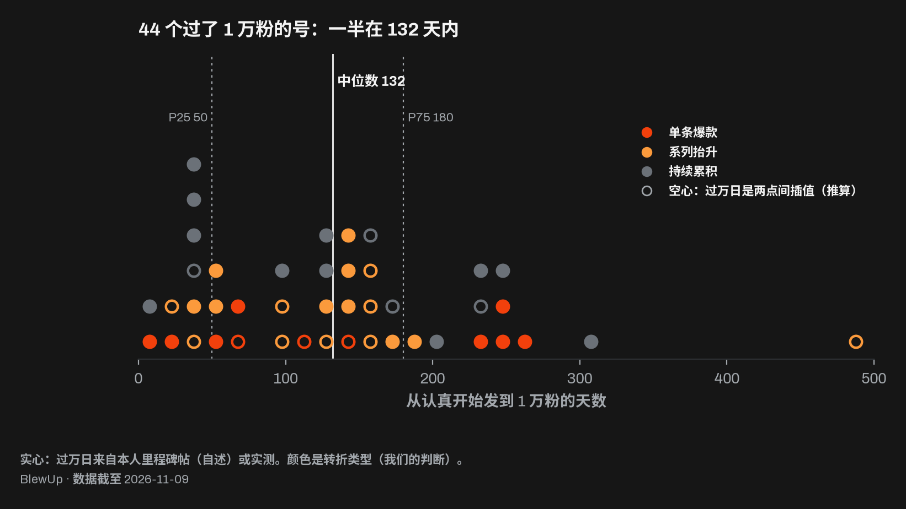
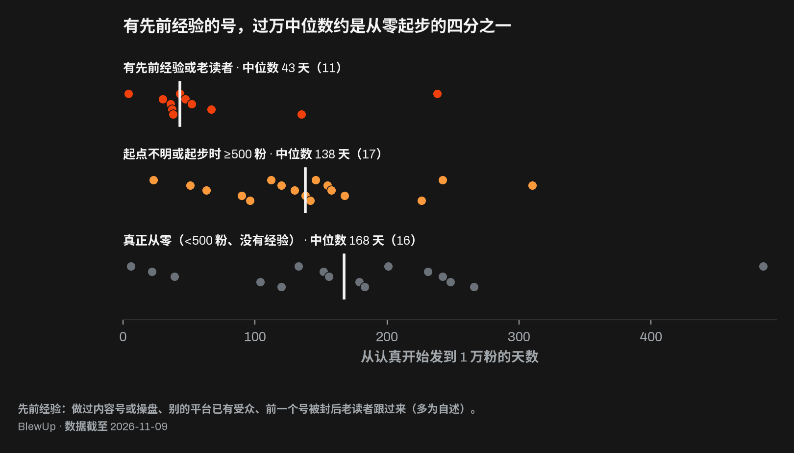
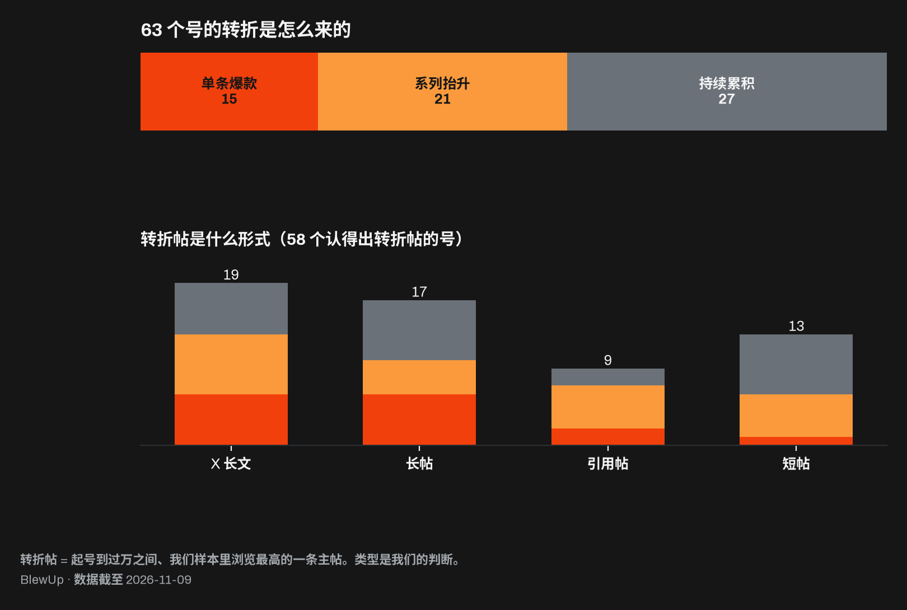
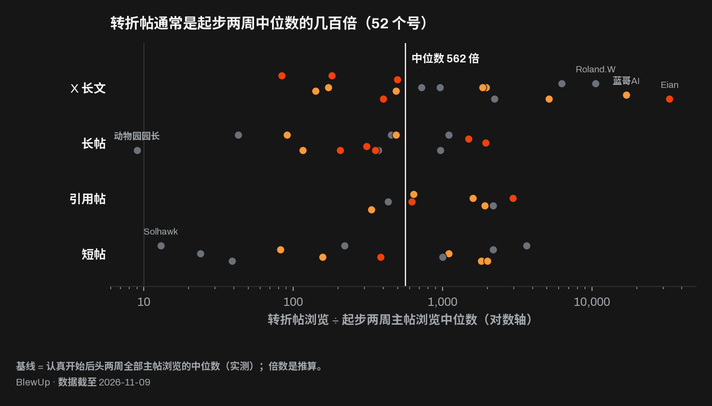
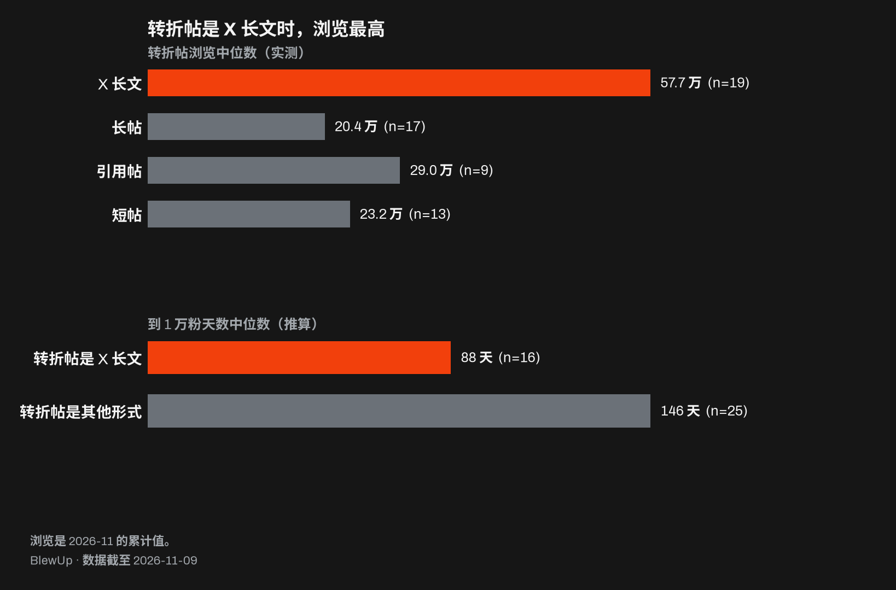
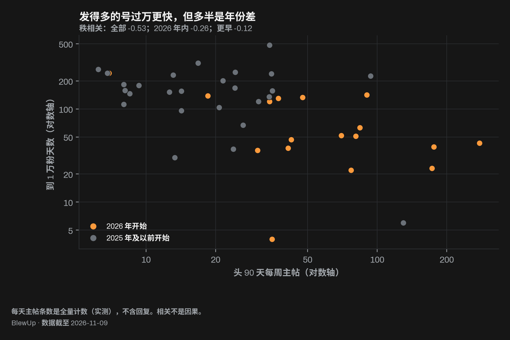
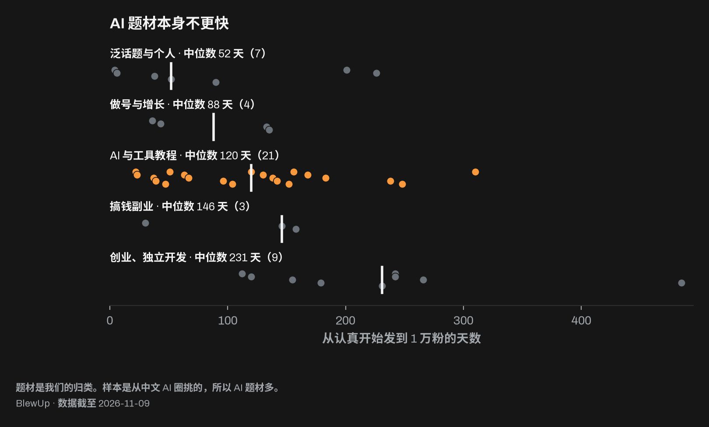
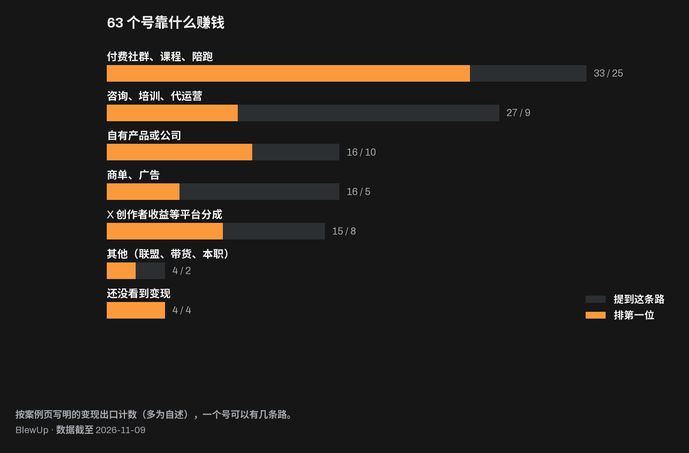

# 如何用 1 天，把你的 𝕏 号做对

你不需要再硬撑一个月、多发几百条。你需要的是一天，把几件事想清楚。我们逐条拆了 63 个 X 号，从认真开始发，到 1 万粉，再往后。快的号不是更自律，而是早早做对了几个选择；慢的号要么做得晚，要么一直没做。下面是数据里的八个发现，和一份让你用一天做完这些选择的功课。

## 八个发现

1. **时钟比你以为的长**：44 个做到 1 万粉的号里，一半用了 132 天以内，最快的四分之一在 50 天内，最慢的 485 天。
2. **从哪儿起步，比你发什么更重要**：带着别处受众来的号，过万中位数 43 天；起步不到 500 粉、也没有经验的，168 天。
3. **你不需要爆一条**：63 个号里，靠一条帖子起来的只有 15 个；21 个靠一个格式连发，27 个看不出转折点。
4. **最好的那条，来得比你想的晚**：它的浏览中位数是起步时的 562 倍，但要走到起号路程的第 71% 才出现。
5. **写长的那一篇**：19 个号的转折帖是 X 长文，浏览中位数 57.7 万；这些号过万 88 天，其他号 146 天。
6. **多发救不了你**：发帖量和过万速度的秩相关是 −0.53，但同一年开始的号里只剩 −0.26 和 −0.12。
7. **捷径不是题材，是教程**：AI 号过万 120 天，其他题材 135 天；但转折帖是工具教程的 17 个号里，15 个过了万。
8. **在你觉得准备好之前，就开始卖**：33 个号卖社群、课程或陪跑；第一次变现中位数在第 80 天，多数早于过万。

## 01 时钟比你以为的长

谁都想要那种故事：一个号一周从零到 1 万。这种事确实有，样本里最快的一个用了 4 天。但它不是你该拿来做计划的故事。

44 个知道过万用时的号里，四分之一在 50 天内，一半在 132 天内，四分之三在 180 天内；最慢的 485 天。另有 10 个号还没到 1 万，9 个过万日不知道。

号从哪儿来，会把时钟拨快或拨慢很多。31 个中文号中位数 96 天，13 个英文号 201 天。但英文样本几乎都是做 App 和独立开发的创始人，中文样本以 AI 内容号为主，46 个里 22 个是 2026 年才开始认真发的。全部样本里 2026 年开始的 17 个过万号中位数 51 天，2025 年的 20 个 154 天。

[Miles Ma](https://blewup.co/zh/cases/milesma/?utm_source=github&utm_medium=repo) 22 天、[柿子](https://blewup.co/zh/cases/shizi/?utm_source=github&utm_medium=repo) 156 天、[Ryan](https://blewup.co/cases/ryangrowth/?utm_source=github&utm_medium=repo) 36 天，都在这张图里。觉得自己慢之前，先在图上找到自己的位置。

*口径：到 1 万粉天数 = 过万日 − 开始认真发的日期。X 不公开历史粉丝数：44 个过万日里 27 个来自本人的里程碑帖，16 个是在相邻两个粉丝数之间线性插值，1 个是数据日当天实测。（自述、推算、实测）*

看案例：[Miles Ma](https://blewup.co/zh/cases/milesma/?utm_source=github&utm_medium=repo) · [柿子](https://blewup.co/zh/cases/shizi/?utm_source=github&utm_medium=repo) · [Ryan](https://blewup.co/cases/ryangrowth/?utm_source=github&utm_medium=repo)

## 02 从哪儿起步，比你发什么更重要

把样本里最快的那批号拉出来看，你会发现一件不太舒服的事：它们几乎都不是从零开始的。

我们把「先前经验」定义为：做过内容号或操盘过别人的号、在别的平台已经有受众、或者前一个号被封后老读者跟了过来。有这类经验的 11 个过万号，中位数 43 天，四分之三在 60 天内。起步不到 500 粉、也没有这些经验的 16 个号，中位数 168 天，四分之一要 234 天以上。

[Kin](https://blewup.co/zh/cases/kin/?utm_source=github&utm_medium=repo) 自述操盘过百万粉的短视频号，47 天；[Koda](https://blewup.co/zh/cases/koda/?utm_source=github&utm_medium=repo) 做了 8 年内容，52 天；[huangserva](https://blewup.co/zh/cases/huangserva/?utm_source=github&utm_medium=repo) 前一个号被封，新号 37 天，起步两周的浏览中位数就有 6,744。经验也不是保证：[文子](https://blewup.co/zh/cases/wenzi/?utm_source=github&utm_medium=repo) 的经验在私域生意，不在公开内容，用了 238 天。

63 个号里真正从零的有 22 个，带着经验或老读者来的 17 个。如果你是那 22 个之一，你的时钟是 168 天，不是 132 天。这不是坏消息，这是你第一次拿到一个能用来做计划的真实数字。

*口径：起点粉丝来自本人自述或账号资料；「先前经验」几乎都是本人说的，归类是我们读了自述后定的。（推算、自述、我们的判断）*

看案例：[Kin](https://blewup.co/zh/cases/kin/?utm_source=github&utm_medium=repo) · [Koda](https://blewup.co/zh/cases/koda/?utm_source=github&utm_medium=repo) · [huangserva](https://blewup.co/zh/cases/huangserva/?utm_source=github&utm_medium=repo)

## 03 你不需要爆一条

关于 X 的建议，大多是关于「那一条」的：写出一条爆款，被大号转一下，第二天醒来涨几千粉。

确实有号是这么起来的。我们叫它单条爆款：一两条帖子之后几天内，涨了过万所需粉丝的三成以上。63 个号里有 15 个，最典型的是 [yan](https://blewup.co/zh/cases/zhanlinyan/?utm_source=github&utm_medium=repo)，一篇两性话题长文 671.6 万浏览，自述 48 小时到 1 万。

另外 48 个不是。21 个靠系列抬升：一个固定格式连着发，几条都远超平时，没有哪一条单独撑起三成，比如 [陈大黄](https://blewup.co/zh/cases/chendahuang/?utm_source=github&utm_medium=repo) 围着自己写的插件连发几十条。27 个是持续累积，看不出任何转折点，比如 [良子](https://blewup.co/zh/cases/liangzi/?utm_source=github&utm_medium=repo)，样本里最高一条不到 1 万浏览，靠每周两百多条主帖、两千多条回复 43 天过万。

没人告诉你的是：三类号过万的速度差不多。单条爆款中位数 112 天，系列 129 天，累积 133 天。等一条爆款不是策略，它甚至不更快。

*口径：转折类型是我们读了案例底稿和粉丝里程碑后的判断；浏览是实测，2026-11 的累计值。（我们的判断、实测、推算）*

看案例：[yan](https://blewup.co/zh/cases/zhanlinyan/?utm_source=github&utm_medium=repo) · [陈大黄](https://blewup.co/zh/cases/chendahuang/?utm_source=github&utm_medium=repo) · [良子](https://blewup.co/zh/cases/liangzi/?utm_source=github&utm_medium=repo)

## 04 最好的那条，来得比你想的晚

把起号到过万之间浏览最高的那条主帖叫「转折帖」。52 个能算倍数的号里，转折帖是起步两周主帖浏览中位数的 562 倍（中位数），51 个超过 10 倍，44 个超过 100 倍。唯一不到 10 倍的是 [动物园园长](https://blewup.co/zh/cases/yuanzhang/?utm_source=github&utm_medium=repo)：起步两周靠朋友转发，中位数就有 5.5 万。

别被倍数唬住，倍数大是因为起步的数太小。「第一条 10 倍帖」几乎人人都有：过万的号中位数第 5 天就出现了，没过万的 10 个号里也有 6 个在头 35 天内出现过。绝对浏览更说明问题：过万的号第一条 10 万浏览的帖子，中位数在第 32 天。

真正要紧的是它什么时候来。以过万用时为 100%，转折帖出现的位置中位数是 71%，只有四分之一的号在一半之前等到。[Cheery](https://blewup.co/zh/cases/cheery/?utm_source=github&utm_medium=repo) 第 204 天、[文子](https://blewup.co/zh/cases/wenzi/?utm_source=github&utm_medium=repo) 第 207 天、[蓝哥AI](https://blewup.co/zh/cases/lange/?utm_source=github&utm_medium=repo) 第 112 天才等到那条。在半路放弃，就是在最要紧的那段之前放弃。

*口径：基线 = 认真开始后头两周全部主帖浏览的中位数（实测）。转折帖是我们样本里最高的一条：多数号的样本是「头两周全量 + 每月热帖 + 近 30 天」，月中的爆款可能漏掉。倍数和位置是推算。（实测、推算）*

看案例：[动物园园长](https://blewup.co/zh/cases/yuanzhang/?utm_source=github&utm_medium=repo) · [Cheery](https://blewup.co/zh/cases/cheery/?utm_source=github&utm_medium=repo) · [蓝哥AI](https://blewup.co/zh/cases/lange/?utm_source=github&utm_medium=repo)

## 05 写长的那一篇

58 个认得出转折帖的号里，19 个的转折帖是 X 长文（Article），17 个是超过 280 字符的长帖，9 个是引用帖，13 个是短帖。长文那 19 条浏览中位数 57.7 万，约是其他三种的 2 到 2.8 倍。转折帖是长文的 16 个过万号，中位数 88 天，其余 25 个 146 天。

长文不需要多。[Kin](https://blewup.co/zh/cases/kin/?utm_source=github&utm_medium=repo) 的长文只占主帖的一小部分，一篇接入微信的教程 162.2 万浏览；[Miles Ma](https://blewup.co/zh/cases/milesma/?utm_source=github&utm_medium=repo) 第 9 天一篇 GitHub 入门长文 33.1 万，22 天过万；[蓝哥AI](https://blewup.co/zh/cases/lange/?utm_source=github&utm_medium=repo) 在 Muse 上线当天写上手教程，215.7 万。早期长文和长帖合计占比的中位数只有 14%。

短帖要的是读者一秒钟的注意力，长文要的是被收藏。写那一篇别人会存下来的。[Thomas Trimoreau](https://blewup.co/cases/trimoreau/?utm_source=github&utm_medium=repo) 几乎只发短帖和回复，133 天也过了万，所以长文不是唯一的路，它只是最省力的那条。

*口径：长文 = X Article；长帖 = 超过 280 个加权字符（中文一个字算 2）。浏览是实测累计值；天数中位数是推算。（实测、推算）*

看案例：[Kin](https://blewup.co/zh/cases/kin/?utm_source=github&utm_medium=repo) · [Miles Ma](https://blewup.co/zh/cases/milesma/?utm_source=github&utm_medium=repo) · [蓝哥AI](https://blewup.co/zh/cases/lange/?utm_source=github&utm_medium=repo)

## 06 多发救不了你

涨不动的时候，第一反应是多发。数据一开始好像也站在这边：起号头 90 天，每周主帖的中位数是 27 条，和过万天数的秩相关是 −0.53；每周 35 条以上的 16 个过万号，中位数 49 天，不到 35 条的 27 个，155 天。

现在按开始年份分开看：2026 年开始的号里只剩 −0.26，更早的号 −0.12。2026 年开始的号普遍发得多（每周中位数 41 条，更早的 21 条），也普遍快。大部分差距来自「什么时候开始」，不是「发了多少」。

两头都有例子：[Adrian Punk](https://blewup.co/zh/cases/adrian-punk/?utm_source=github&utm_medium=repo) 头 90 天每周约 176 条主帖，约 39 天过万；[Alex](https://blewup.co/cases/hispanicnomad/?utm_source=github&utm_medium=repo) 每周 93 条，用了 226 天；[Mau Baron](https://blewup.co/cases/maubaron/?utm_source=github&utm_medium=repo) 每周 8 条，112 天。回复也一样：回复量和过万天数的秩相关是 −0.36，但回复和主帖的比例和速度几乎无关（+0.08）。发帖量是你要付的成本，不是一拉就灵的杠杆。

*口径：每天主帖和回复条数是全量计数（实测）；过万天数和相关系数是推算。这是相关，不是因果。（实测、推算、我们的判断）*

看案例：[Adrian Punk](https://blewup.co/zh/cases/adrian-punk/?utm_source=github&utm_medium=repo) · [Alex](https://blewup.co/cases/hispanicnomad/?utm_source=github&utm_medium=repo) · [Mau Baron](https://blewup.co/cases/maubaron/?utm_source=github&utm_medium=repo)

## 07 捷径不是题材，是教程

63 个号里 33 个做 AI 与工具教程，因为候选名单本来就是从中文 AI 圈挑的。你大概会以为 AI 是快车道，其实不是：AI 类 21 个过万号中位数 120 天，其他题材 23 个 135 天。只看中文、没有先前经验的号：AI 17 个 130 天，非 AI 4 个 118 天。

题材之间看起来差得更远：泛话题与个人最快（52 天），创业和独立开发最慢（231 天）。但泛话题这 7 个里有 3 个带着先前经验或老读者，最快的 6 天（[Solhawk](https://blewup.co/zh/cases/solhawk/?utm_source=github&utm_medium=repo)）两端都是自述；创业那 9 个全是英文、全是没有先前经验的创始人。题材和起点缠在一起。

真正有差别的是写法：转折帖是工具教程的 17 个号里，15 个过了万，例如 [雪踏乌云](https://blewup.co/zh/cases/xuetawuyun/?utm_source=github&utm_medium=repo)、[Kin](https://blewup.co/zh/cases/kin/?utm_source=github&utm_medium=repo)；没过的两个是 [孙可可](https://blewup.co/zh/cases/sunkeke/?utm_source=github&utm_medium=repo) 和 Ojas Sharma。挑一个你天天在用、停不下来的东西，然后把它教给别人。

*口径：题材和转折帖题材都是我们读原文后的归类；天数中位数是推算。（我们的判断、推算）*

看案例：[雪踏乌云](https://blewup.co/zh/cases/xuetawuyun/?utm_source=github&utm_medium=repo) · [Kin](https://blewup.co/zh/cases/kin/?utm_source=github&utm_medium=repo) · [孙可可](https://blewup.co/zh/cases/sunkeke/?utm_source=github&utm_medium=repo)

## 08 在你觉得准备好之前，就开始卖

63 个号里，33 个提到付费社群、课程或陪跑，25 个把它排第一；咨询、培训、代运营 27 个；自有产品或公司 16 个；商单 16 个；X 创作者收益等平台分成 15 个；还没看到变现的 4 个。

中英文不一样：46 个中文号里 23 个把付费社群和课程排第一；17 个英文号里 8 个排第一的是自己的产品或公司，X 是获客渠道，例如 [Vitalii Dodonov](https://blewup.co/cases/vitalii/?utm_source=github&utm_medium=repo)。

最值得抄的是时间点。能看到第一次变现信号（宣布付费群、开通创作者收益、接到第一单）的 22 个号，中位数在认真开始后第 80 天。既过了万、又看得到变现信号的 16 个号里，13 个的第一次变现早于过万。[孙可可](https://blewup.co/zh/cases/sunkeke/?utm_source=github&utm_medium=repo) 第 9 天、[Kin](https://blewup.co/zh/cases/kin/?utm_source=github&utm_medium=repo) 第 14 天就宣布了付费群。多数人没等到 1 万粉。

*口径：变现出口按案例页写明的计数，一个号可以有几条路；几乎都是本人自述。变现天数只有 22 个号有信号。（自述、推算）*

看案例：[Kin](https://blewup.co/zh/cases/kin/?utm_source=github&utm_medium=repo) · [孙可可](https://blewup.co/zh/cases/sunkeke/?utm_source=github&utm_medium=repo) · [Vitalii Dodonov](https://blewup.co/cases/vitalii/?utm_source=github&utm_medium=repo)

## 1 天的功课

读完这篇什么都不会变，做完才可能变。

空出完整的一天。准备一个本子、你的主页，和你自己最近 90 天发过的帖子。这一天你要做四个决定：上午一个，下午两个，晚上一个。每一个都来自上面的八个发现。

### 上午：定你的时钟

在纸上老老实实回答：

- 现在有谁已经在别的地方听我说话？老号、别的平台、公众号、社群、同事？
- 我做过的东西里，有哪些别人用过、付过钱、转发过？
- 我真的是从零开始吗？

然后写下一个数。别处有真实受众的，你的参照是 43 天；起步不到 500 粉、也没有这些的，是 168 天；起步 500 粉以上、但别处没有受众的，是 138 天。这个数不是截止日期，是你答应自己在判断结果之前要坚持多久。

### 下午第一件：选一件你要反复写的事

- 哪个工具或话题，不管有没有人看，我每周都在用？
- 新手卡在哪一步，是我能配着截图讲清楚的？

围绕它写出十个选题，用同一个能重复的格式：结构一样，问题不同。凑不到十个，就说明选错了，换一个重来。这十个就是你的系列。

### 下午第二件：写长的那一篇

起草你的第一篇 X 长文：写那份你当初刚接触这件事时，最希望有人写给你的完整指南。今天不用发，今天写完。长文只需要占你主帖的七分之一左右，这就是那一篇。

### 晚上：定你的信号

在本子上写三行：

1. **我的信号**：第一条 10 万浏览的帖子。过万的号中位数在第 32 天等到它。
2. **我的半程规则**：转折帖出现在过万路程的第 71%。走到一半还没动静，说明我在正常进度上，格式不换。
3. **我的第一个产品**：卖什么、哪天上线。第 80 天前后，在 1 万粉之前。

最后定一个发帖量：一个你能撑完整个时钟的量，而不是这周看起来很努力的量。合上本子。明天开始发。

*口径：这份功课是我们把上面八个发现落到做法上的方式，里面每个数都来自前面的章节。（我们的判断）*

## 样本表

一行一个号，按到 1 万粉的天数排。

- [yan](https://blewup.co/zh/cases/zhanlinyan/?utm_source=github&utm_medium=repo) @ZhanlinYan74392：中文，开始认真发 2026-09-03，到 1 万粉 4 天（自述），现粉丝 3.1 万，转折 单条爆款，转折帖 X 长文 · 671.6 万，头 90 天每周主帖 35，题材 泛话题与个人，主要变现 咨询服务
- [Solhawk](https://blewup.co/zh/cases/solhawk/?utm_source=github&utm_medium=repo) @SolhawkGo：中文，开始认真发 2025-05-02，到 1 万粉 6 天（自述），现粉丝 2.8 万，转折 持续累积，转折帖 短帖 · 1.4 万，头 90 天每周主帖 130，题材 泛话题与个人，主要变现 社群课程
- [Miles Ma](https://blewup.co/zh/cases/milesma/?utm_source=github&utm_medium=repo) @miles_mazy：中文，开始认真发 2026-08-07，到 1 万粉 22 天（推算），现粉丝 3.9 万，转折 系列抬升，转折帖 X 长文 · 33.1 万，头 90 天每周主帖 77，题材 AI 与工具，主要变现 社群课程
- [黄小木](https://blewup.co/zh/cases/xiaomu/?utm_source=github&utm_medium=repo) @ai_xiaomu：中文，开始认真发 2026-04-02，到 1 万粉 23 天（自述），现粉丝 5.6 万，转折 单条爆款，转折帖 长帖 · 32 万，头 90 天每周主帖 173，题材 AI 与工具，主要变现 咨询服务
- [动物园园长](https://blewup.co/zh/cases/yuanzhang/?utm_source=github&utm_medium=repo) @weiyux2021：中文，开始认真发 2025-11-29，到 1 万粉 30 天（自述），现粉丝 9.6 万，转折 持续累积，转折帖 长帖 · 50.1 万，头 90 天每周主帖 13，题材 搞钱副业，主要变现 社群课程
- [Ryan](https://blewup.co/cases/ryangrowth/?utm_source=github&utm_medium=repo) @ryangrowthh：英文，开始认真发 2026-10-03，到 1 万粉 36 天（实测），现粉丝 1 万，转折 系列抬升，转折帖 X 长文 · 46.5 万，头 90 天每周主帖 30，题材 做号与增长，主要变现 其他
- [huangserva](https://blewup.co/zh/cases/huangserva/?utm_source=github&utm_medium=repo) @servasyy_ai：中文，开始认真发 2025-12-11，到 1 万粉 37 天（自述），现粉丝 4.3 万，转折 持续累积，转折帖 长帖 · 29 万，头 90 天每周主帖 24，题材 AI 与工具，主要变现 商单
- [杨高能](https://blewup.co/zh/cases/yanggaoneng/?utm_source=github&utm_medium=repo) @430Yang：中文，开始认真发 2026-01-07，到 1 万粉 38 天（推算），现粉丝 4.1 万，转折 系列抬升，转折帖 引用帖 · 26.9 万，头 90 天每周主帖 41，题材 泛话题与个人，主要变现 咨询服务
- [Adrian Punk](https://blewup.co/zh/cases/adrian-punk/?utm_source=github&utm_medium=repo) @AdrianPunk115：中文，开始认真发 2026-04-24，到 1 万粉 39 天（推算），现粉丝 4.5 万，转折 持续累积，转折帖 X 长文 · 8.9 万，头 90 天每周主帖 176，题材 AI 与工具，主要变现 社群课程
- [良子](https://blewup.co/zh/cases/liangzi/?utm_source=github&utm_medium=repo) @xuliang198241：中文，开始认真发 2026-09-15，到 1 万粉 43 天（自述），现粉丝 1.1 万，转折 持续累积，转折帖 短帖 · 9,881，头 90 天每周主帖 277，题材 做号与增长，主要变现 平台分成
- [Kin](https://blewup.co/zh/cases/kin/?utm_source=github&utm_medium=repo) @KinGao476942：中文，开始认真发 2026-09-01，到 1 万粉 47 天（自述），现粉丝 1.5 万，转折 单条爆款，转折帖 X 长文 · 162.2 万，头 90 天每周主帖 42，题材 AI 与工具，主要变现 社群课程
- [金尘马](https://blewup.co/zh/cases/jinchenma/?utm_source=github&utm_medium=repo) @jinchenma_ai：中文，开始认真发 2026-03-05，到 1 万粉 51 天（自述），现粉丝 3.4 万，转折 系列抬升，转折帖 X 长文 · 62.5 万，头 90 天每周主帖 81，题材 AI 与工具，主要变现 社群课程
- [Koda](https://blewup.co/zh/cases/koda/?utm_source=github&utm_medium=repo) @wadezone：中文，开始认真发 2026-03-14，到 1 万粉 52 天（自述），现粉丝 3.1 万，转折 系列抬升，转折帖 X 长文 · 68.1 万，头 90 天每周主帖 70，题材 泛话题与个人，主要变现 咨询服务
- [Eian](https://blewup.co/zh/cases/eian/?utm_source=github&utm_medium=repo) @EianLu：中文，开始认真发 2026-09-04，到 1 万粉 63 天（推算），现粉丝 3.6 万，转折 单条爆款，转折帖 X 长文 · 532.7 万，头 90 天每周主帖 84，题材 AI 与工具，主要变现 商单
- [雪踏乌云](https://blewup.co/zh/cases/xuetawuyun/?utm_source=github&utm_medium=repo) @Pluvio9yte：中文，开始认真发 2025-10-09，到 1 万粉 67 天（自述），现粉丝 8.2 万，转折 单条爆款，转折帖 长帖 · 4.8 万，头 90 天每周主帖 26，题材 AI 与工具，主要变现 咨询服务
- [Mr Panda](https://blewup.co/zh/cases/mrpanda/?utm_source=github&utm_medium=repo) @PandaTalk8：中文，开始认真发 2024-01-01，到 1 万粉 90 天（自述），现粉丝 7.8 万，转折 持续累积，转折帖 —，头 90 天每周主帖 —，题材 泛话题与个人，主要变现 社群课程
- [鱼总聊AI](https://blewup.co/zh/cases/yuzong/?utm_source=github&utm_medium=repo) @AI_Jasonyu：中文，开始认真发 2025-09-10，到 1 万粉 96 天（推算），现粉丝 7.3 万，转折 系列抬升，转折帖 长帖 · 84.2 万，头 90 天每周主帖 14，题材 AI 与工具，主要变现 其他
- [Jason Zhu](https://blewup.co/zh/cases/jasonzhu/?utm_source=github&utm_medium=repo) @GoSailGlobal：中文，开始认真发 2025-07-27，到 1 万粉 104 天（推算），现粉丝 4 万，转折 系列抬升，转折帖 引用帖 · 8.7 万，头 90 天每周主帖 21，题材 AI 与工具，主要变现 社群课程
- [Mau Baron](https://blewup.co/cases/maubaron/?utm_source=github&utm_medium=repo) @maubaron：英文，开始认真发 2025-11-14，到 1 万粉 112 天（推算），现粉丝 2.1 万，转折 单条爆款，转折帖 X 长文 · 197.2 万，头 90 天每周主帖 8，题材 创业、独立开发，主要变现 自有产品
- [陈大黄](https://blewup.co/zh/cases/chendahuang/?utm_source=github&utm_medium=repo) @realchendahuang：中文，开始认真发 2026-06-14，到 1 万粉 120 天（推算），现粉丝 1.4 万，转折 系列抬升，转折帖 短帖 · 132.5 万，头 90 天每周主帖 34，题材 AI 与工具，主要变现 未见
- [Aditya](https://blewup.co/cases/adityaships/?utm_source=github&utm_medium=repo) @AdityaShips：英文，开始认真发 2025-06-01，到 1 万粉 120 天（自述），现粉丝 1.8 万，转折 系列抬升，转折帖 短帖 · 5.3 万，头 90 天每周主帖 31，题材 创业、独立开发，主要变现 平台分成
- [铁柱AGI](https://blewup.co/zh/cases/tiezhu/?utm_source=github&utm_medium=repo) @cgnot996：中文，开始认真发 2026-06-16，到 1 万粉 130 天（自述），现粉丝 1.3 万，转折 持续累积，转折帖 X 长文 · 22.3 万，头 90 天每周主帖 37，题材 AI 与工具，主要变现 社群课程
- [Thomas Trimoreau](https://blewup.co/cases/trimoreau/?utm_source=github&utm_medium=repo) @TTrimoreau：英文，开始认真发 2026-01-27，到 1 万粉 133 天（自述），现粉丝 1.7 万，转折 持续累积，转折帖 短帖 · 71 万，头 90 天每周主帖 48，题材 做号与增长，主要变现 平台分成
- [王赞](https://blewup.co/zh/cases/wangzan/?utm_source=github&utm_medium=repo) @wangzan101：中文，开始认真发 2025-12-25，到 1 万粉 135 天（推算），现粉丝 1.8 万，转折 单条爆款，转折帖 X 长文 · 46.8 万，头 90 天每周主帖 34，题材 做号与增长，主要变现 平台分成
- [蓝哥AI](https://blewup.co/zh/cases/lange/?utm_source=github&utm_medium=repo) @0xlangeai：中文，开始认真发 2026-06-05，到 1 万粉 138 天（自述），现粉丝 1.2 万，转折 系列抬升，转折帖 X 长文 · 215.7 万，头 90 天每周主帖 18，题材 AI 与工具，主要变现 社群课程
- [苏乐](https://blewup.co/zh/cases/sule/?utm_source=github&utm_medium=repo) @ai_suxiaole：中文，开始认真发 2026-05-13，到 1 万粉 142 天（自述），现粉丝 1.2 万，转折 系列抬升，转折帖 X 长文 · 57.7 万，头 90 天每周主帖 90，题材 AI 与工具，主要变现 未见
- [皮大点事](https://blewup.co/zh/cases/pidadianshi/?utm_source=github&utm_medium=repo) @Amateur8888：中文，开始认真发 2024-01-06，到 1 万粉 146 天（自述），现粉丝 2.3 万，转折 系列抬升，转折帖 短帖 · 25.2 万，头 90 天每周主帖 8，题材 搞钱副业，主要变现 平台分成
- [Rion Wu](https://blewup.co/zh/cases/rionwu/?utm_source=github&utm_medium=repo) @rionaifantasy：中文，开始认真发 2025-11-01，到 1 万粉 152 天（推算），现粉丝 1.9 万，转折 系列抬升，转折帖 长帖 · 14.8 万，头 90 天每周主帖 13，题材 AI 与工具，主要变现 平台分成
- [Vitalii Dodonov](https://blewup.co/cases/vitalii/?utm_source=github&utm_medium=repo) @vitaliidodonov：英文，开始认真发 2025-12-27，到 1 万粉 155 天（推算），现粉丝 2.3 万，转折 系列抬升，转折帖 长帖 · 10.4 万，头 90 天每周主帖 14，题材 创业、独立开发，主要变现 自有产品
- [柿子](https://blewup.co/zh/cases/shizi/?utm_source=github&utm_medium=repo) @yaohui12138：中文，开始认真发 2025-09-04，到 1 万粉 156 天（推算），现粉丝 2.6 万，转折 持续累积，转折帖 长帖 · 20.4 万，头 90 天每周主帖 35，题材 AI 与工具，主要变现 社群课程
- [Sac](https://blewup.co/zh/cases/sac/?utm_source=github&utm_medium=repo) @Saccc_c：中文，开始认真发 2025-11-03，到 1 万粉 158 天（推算），现粉丝 5.5 万，转折 系列抬升，转折帖 X 长文 · 67.9 万，头 90 天每周主帖 8，题材 搞钱副业，主要变现 商单
- [叫我阿杭](https://blewup.co/zh/cases/ahang/?utm_source=github&utm_medium=repo) @Astronaut_1216：中文，开始认真发 2025-10-01，到 1 万粉 168 天（推算），现粉丝 3.1 万，转折 持续累积，转折帖 长帖 · 14.2 万，头 90 天每周主帖 24，题材 AI 与工具，主要变现 社群课程
- [Jay Dwivedi](https://blewup.co/cases/jaydwivedi/?utm_source=github&utm_medium=repo) @jaydwivedi_：英文，开始认真发 2024-08-21，到 1 万粉 179 天（自述），现粉丝 4.2 万，转折 系列抬升，转折帖 引用帖 · 34.8 万，头 90 天每周主帖 9，题材 创业、独立开发，主要变现 咨询服务
- [阿西_出海](https://blewup.co/zh/cases/axichuhai/?utm_source=github&utm_medium=repo) @axichuhai：中文，开始认真发 2024-12-13，到 1 万粉 183 天（自述），现粉丝 2.7 万，转折 系列抬升，转折帖 短帖 · 8.7 万，头 90 天每周主帖 8，题材 AI 与工具，主要变现 社群课程
- [Brian Maierhofer](https://blewup.co/cases/brianmaierhofer/?utm_source=github&utm_medium=repo) @brianmaierhofer：英文，开始认真发 2023-11-27，到 1 万粉 201 天（自述），现粉丝 7.9 万，转折 持续累积，转折帖 —，头 90 天每周主帖 22，题材 泛话题与个人，主要变现 社群课程
- [Alex](https://blewup.co/cases/hispanicnomad/?utm_source=github&utm_medium=repo) @hispanicnomad：英文，开始认真发 2025-06-05，到 1 万粉 226 天（自述），现粉丝 2.5 万，转折 持续累积，转折帖 —，头 90 天每周主帖 93，题材 泛话题与个人，主要变现 社群课程
- [jia](https://blewup.co/cases/jia/?utm_source=github&utm_medium=repo) @jia_seed：英文，开始认真发 2025-01-01，到 1 万粉 231 天（自述），现粉丝 2.1 万，转折 单条爆款，转折帖 长帖 · 17.2 万，头 90 天每周主帖 13，题材 创业、独立开发，主要变现 自有产品
- [文子](https://blewup.co/zh/cases/wenzi/?utm_source=github&utm_medium=repo) @Eejoylove：中文，开始认真发 2025-12-11，到 1 万粉 238 天（推算），现粉丝 1.4 万，转折 持续累积，转折帖 X 长文 · 43.1 万，头 90 天每周主帖 35，题材 AI 与工具，主要变现 社群课程
- [Pierre-Louis Biojout](https://blewup.co/cases/plbiojout/?utm_source=github&utm_medium=repo) @plbiojout：英文，开始认真发 2026-03-05，到 1 万粉 242 天（自述），现粉丝 1.1 万，转折 单条爆款，转折帖 长帖 · 235.3 万，头 90 天每周主帖 7，题材 创业、独立开发，主要变现 自有产品
- [Rexan Wong](https://blewup.co/cases/rexan/?utm_source=github&utm_medium=repo) @rexan_wong：英文，开始认真发 2024-05-02，到 1 万粉 242 天（自述），现粉丝 2.5 万，转折 单条爆款，转折帖 引用帖 · 41.6 万，头 90 天每周主帖 7，题材 创业、独立开发，主要变现 自有产品
- [木马人](https://blewup.co/zh/cases/mumaren/?utm_source=github&utm_medium=repo) @cnyzgkc：中文，开始认真发 2025-08-13，到 1 万粉 248 天（自述），现粉丝 1.9 万，转折 持续累积，转折帖 长帖 · 19.1 万，头 90 天每周主帖 24，题材 AI 与工具，主要变现 平台分成
- [Eliana](https://blewup.co/cases/eliana/?utm_source=github&utm_medium=repo) @eliana_jordan：英文，开始认真发 2024-12-22，到 1 万粉 266 天（自述），现粉丝 3.4 万，转折 单条爆款，转折帖 短帖 · 11.9 万，头 90 天每周主帖 6，题材 创业、独立开发，主要变现 自有产品
- [Cheery](https://blewup.co/zh/cases/cheery/?utm_source=github&utm_medium=repo) @cheery9998：中文，开始认真发 2025-12-10，到 1 万粉 310 天（自述），现粉丝 1.1 万，转折 持续累积，转折帖 X 长文 · 14.8 万，头 90 天每周主帖 17，题材 AI 与工具，主要变现 社群课程
- [Adrià Martinez](https://blewup.co/cases/adriamatz/?utm_source=github&utm_medium=repo) @adriamatz：英文，开始认真发 2025-04-01，到 1 万粉 485 天（推算），现粉丝 1.3 万，转折 系列抬升，转折帖 引用帖 · 29 万，头 90 天每周主帖 34，题材 创业、独立开发，主要变现 自有产品
- [阿策](https://blewup.co/zh/cases/ace/?utm_source=github&utm_medium=repo) @Bytec99：中文，开始认真发 2026-03-23，到 1 万粉 —，现粉丝 4,950，转折 单条爆款，转折帖 长帖 · 22.8 万，头 90 天每周主帖 6，题材 AI 与工具，主要变现 社群课程
- [冰河](https://blewup.co/zh/cases/binghe/?utm_source=github&utm_medium=repo) @binghe：中文，开始认真发 2024-12-13，到 1 万粉 —，现粉丝 4.8 万，转折 持续累积，转折帖 长帖 · 20.8 万，头 90 天每周主帖 10，题材 搞钱副业，主要变现 社群课程
- [歸藏](https://blewup.co/zh/cases/guizang/?utm_source=github&utm_medium=repo) @op7418：中文，开始认真发 2023-02-07，到 1 万粉 —，现粉丝 26.6 万，转折 持续累积，转折帖 长帖 · 15.5 万，头 90 天每周主帖 31，题材 AI 与工具，主要变现 社群课程
- [Jack Flux](https://blewup.co/zh/cases/jackflux/?utm_source=github&utm_medium=repo) @Jack_FluxAI：中文，开始认真发 2026-07-04，到 1 万粉 —，现粉丝 4,482，转折 持续累积，转折帖 引用帖 · 16.5 万，头 90 天每周主帖 93，题材 AI 与工具，主要变现 咨询服务
- [Jackywine](https://blewup.co/zh/cases/jackywine/?utm_source=github&utm_medium=repo) @Jackywine：中文，开始认真发 —，到 1 万粉 —，现粉丝 5 万，转折 持续累积，转折帖 —，头 90 天每周主帖 —，题材 AI 与工具，主要变现 社群课程
- [良竹](https://blewup.co/zh/cases/liangzhu/?utm_source=github&utm_medium=repo) @liangzhu_AI：中文，开始认真发 2026-09-24，到 1 万粉 —，现粉丝 8,065，转折 单条爆款，转折帖 X 长文 · 46.7 万，头 90 天每周主帖 141，题材 AI 与工具，主要变现 未见
- [躺在废墟里](https://blewup.co/zh/cases/lieflat/?utm_source=github&utm_medium=repo) @lieflat_3：中文，开始认真发 2026-09-01，到 1 万粉 —，现粉丝 5,249，转折 单条爆款，转折帖 长帖 · 62 万，头 90 天每周主帖 6，题材 AI 与工具，主要变现 未见
- [明野](https://blewup.co/zh/cases/mingye/?utm_source=github&utm_medium=repo) @tou_de74826：中文，开始认真发 2026-09-18，到 1 万粉 —，现粉丝 7,970，转折 持续累积，转折帖 短帖 · 58.3 万，头 90 天每周主帖 174，题材 泛话题与个人，主要变现 社群课程
- [向阳乔木](https://blewup.co/zh/cases/qiaomu/?utm_source=github&utm_medium=repo) @vista8：中文，开始认真发 2023-03-01，到 1 万粉 —，现粉丝 14.2 万，转折 持续累积，转折帖 引用帖 · 30.4 万，头 90 天每周主帖 34，题材 AI 与工具，主要变现 商单
- [Roland.W](https://blewup.co/zh/cases/rwayne/?utm_source=github&utm_medium=repo) @rwayne：中文，开始认真发 2025-11-01，到 1 万粉 —，现粉丝 6.3 万，转折 持续累积，转折帖 X 长文 · 144.3 万，头 90 天每周主帖 35，题材 泛话题与个人，主要变现 自有产品
- [孙可可](https://blewup.co/zh/cases/sunkeke/?utm_source=github&utm_medium=repo) @Sunkeke_AI：中文，开始认真发 2026-06-28，到 1 万粉 —，现粉丝 3,895，转折 单条爆款，转折帖 引用帖 · 9.7 万，头 90 天每周主帖 25，题材 AI 与工具，主要变现 商单
- [铁锤人](https://blewup.co/zh/cases/tiechuiren/?utm_source=github&utm_medium=repo) @lxfater：中文，开始认真发 2023-01-25，到 1 万粉 —，现粉丝 11.7 万，转折 系列抬升，转折帖 短帖 · 23.2 万，头 90 天每周主帖 9，题材 AI 与工具，主要变现 自有产品
- [小互](https://blewup.co/zh/cases/xiaohu/?utm_source=github&utm_medium=repo) @xiaohu：中文，开始认真发 2024-03-05，到 1 万粉 —，现粉丝 12.7 万，转折 持续累积，转折帖 短帖 · 27.9 万，头 90 天每周主帖 53，题材 AI 与工具，主要变现 社群课程
- [小晚不在](https://blewup.co/zh/cases/xiaowan/?utm_source=github&utm_medium=repo) @bbkirstry：中文，开始认真发 2026-05-17，到 1 万粉 —，现粉丝 6,454，转折 持续累积，转折帖 X 长文 · 8.8 万，头 90 天每周主帖 19，题材 AI 与工具，主要变现 社群课程
- [逸尘](https://blewup.co/zh/cases/yichen/?utm_source=github&utm_medium=repo) @gengdaJ：中文，开始认真发 2026-01-04，到 1 万粉 —，现粉丝 6.4 万，转折 系列抬升，转折帖 引用帖 · 204.2 万，头 90 天每周主帖 15，题材 AI 与工具，主要变现 社群课程
- [GBE](https://blewup.co/cases/gbe/?utm_source=github&utm_medium=repo) @HeyYoGB：英文，开始认真发 2026-06-18，到 1 万粉 —，现粉丝 1 万，转折 系列抬升，转折帖 长帖 · 3.8 万，头 90 天每周主帖 27，题材 做号与增长，主要变现 咨询服务
- [Jonathan](https://blewup.co/cases/joniverbeet/?utm_source=github&utm_medium=repo) @joniverbeet：英文，开始认真发 2026-02-01，到 1 万粉 —，现粉丝 5,527，转折 持续累积，转折帖 短帖 · 3.8 万，头 90 天每周主帖 26，题材 创业、独立开发，主要变现 自有产品
- [Ojas Sharma](https://blewup.co/cases/ojas/?utm_source=github&utm_medium=repo) @OjasSharma276：英文，开始认真发 2025-10-17，到 1 万粉 —，现粉丝 8,004，转折 持续累积，转折帖 短帖 · 26.1 万，头 90 天每周主帖 80，题材 创业、独立开发，主要变现 平台分成
- [Tom Hughes](https://blewup.co/cases/tomhughes/?utm_source=github&utm_medium=repo) @TomHughesx：英文，开始认真发 2024-07-29，到 1 万粉 —，现粉丝 3,257，转折 持续累积，转折帖 —，头 90 天每周主帖 6，题材 做号与增长，主要变现 咨询服务

## 方法和局限

### 样本怎么来的

样本是 BlewUp 站上截至 2026-11-09 的全部 63 个 X 案例：中文 46 个、英文 17 个，每个号都有一页案例。案例是按「起来了或正在起来」挑的，所以这份报告只能说「起来的号有什么共同点」，不能说「做了这些就能起来」。没有一个对照组：同样发了半年、没起来的号不在样本里。

### 样本偏在哪

- **样本偏向中文 AI 圈。** 33 个号做 AI 与工具教程，中文号占四分之三，候选名单本来就是从中文 AI 圈挑的。英文号几乎全是做 App 和独立开发的创始人。语言、题材、起点三者缠在一起，分组差异都要带着这个看。
- **偏向最近。** 27 个号是 2026 年才开始认真发的，赶上中文 AI 工具的热点密集期。
- **一部分案例是按「突破型」门槛挑的**，会把起号用时往短里拉。

### 哪些是自述

- **过万日**：44 个里 27 个来自本人的里程碑帖（自述），16 个是两个粉丝数之间的线性插值（推算），1 个实测。X 不公开历史粉丝数，这是最大的不确定来源；插值间隔长的号，误差可能有一两个月。
- **起点粉丝**：63 个里 28 个不知道。
- **先前经验、团队、变现**：几乎全是本人说的。有没有团队和 AI 代写看不全，会让「一个人能做到多少」被高估。

### 数据口径

- **主帖浏览是抽样的**：只有少数号有爬坡期的逐条全量，其余是「头两周全量 + 每月热帖 + 近 30 天」。转折帖是样本里最高的一条，月中的爆款可能漏掉。
- **浏览是 2026-11 的累计值**，不是发帖当时的浏览。
- **每天主帖和回复条数是全量计数**，不受抽样影响；34 个号有逐日回复计数。
- **转折类型、题材、先前经验**都是人工归类（我们的判断）。

每个数字都有标注：实测 = 平台上能核对到的数；推算 = 由事实计算；自述 = 创作者自己说的；我们的判断 = 根据数据的解读

---

这份报告的网页版有可排序的样本表和每个案例的链接：https://blewup.co/zh/reports/x-growth/?utm_source=github&utm_medium=repo
